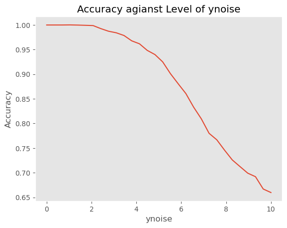
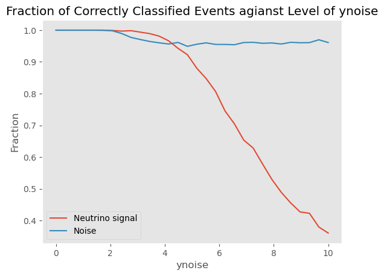
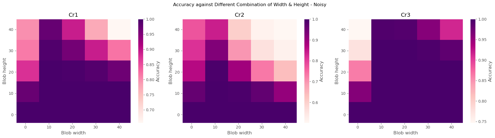

# Supernova neutrino classification

A convolutional neural network distinguishes simulated neutrino-event images from background in a liquid-argon time-projection chamber. The analysis compares training with clean and noisy images, scans sensitivity to electronic noise and Gaussian-blob backgrounds, and examines misclassified events using particle metadata.

The complete workflow is in [supernova_classification.ipynb](supernova_classification.ipynb).

## Method and results

The binary CNN uses two convolution/max-pooling blocks, a dense layer, dropout and a sigmoid output. Electronic noise is zero-mean Gaussian noise; the radiological background is a toy model with two Gaussian views sharing a three-dimensional centre. Training and testing use disjoint event blocks, and paired views remain in the same split.

- Training only on noisy backgrounds does not make the classifier robust to noisy signal images. C2, trained with noise on both classes at standard deviation 5, tolerates larger noise amplitudes.
- In the C2 scan below, accuracy falls from nearly 1 at low noise to about 0.66 at standard deviation 10. Most of the loss comes from missed signal events; background recall remains around 0.95.
- Blob sensitivity depends on both the training configuration and the blob shape. Narrow, tall blobs and large overlays can reduce accuracy.




The C2 scans use the last 3,000 signal images and 3,000 background images. In these figures, `ynoise` is the Gaussian standard deviation in image-amplitude units; “Noise” denotes background recall.



Cr1, Cr2 and Cr3 train with `(width, height)` equal to `(5, 20)`, `(10, 5)` and `(15, 15)`. Their scans use paired views of the last 2,000 signal events and 4,000 background views. The panels have separate colour scales. `height` controls both amplitude and vertical extent in this toy model; it is not a calibrated decay energy.

These are exploratory noise scans, with run-dependent training and noise realisations. They do not establish detector efficiency or isotope-specific rejection. Exact sample counts and training settings are given alongside the corresponding notebook cells.

## Data

The image data, metadata schema and task setup are supplied with the Supernova miniproject in *Practical Machine Learning*. The accompanying FAQ is by Cheryl Patrick and Ryan Nichol (December 2020). Obtain the files through the course or its data provider; they are not distributed here.

| File | Expected contents |
| --- | --- |
| `larImages.npy` | Floating-point array of shape `(10000, 100, 100)`; about 800 MB |
| `meta.npy` | Numeric array of shape `(10000, 64)`; column 1 is neutrino energy in MeV and column 3 is the final-state particle count |

Place both files in `data/`, or set `SUPERNOVA_DATA_DIR` to their directory. Background images are generated in the notebook. Particle metadata is used for interpretation only, not as a classifier input.

## Run

Use Python 3.11–3.13 with TensorFlow, NumPy, Matplotlib and JupyterLab:

```bash
python3 -m venv .venv
source .venv/bin/activate
python -m pip install -r requirements.txt
jupyter lab supernova_classification.ipynb
```

For data stored elsewhere, set the path before starting Jupyter:

```bash
export SUPERNOVA_DATA_DIR="/path/to/supernova-data"
jupyter lab supernova_classification.ipynb
```

Run the cells from top to bottom. The notebook trains the classifiers from scratch, including a 100-epoch C2 run and several 6-epoch blob models; the full analysis can be slow on a CPU and needs several GB of memory. Generated scans and figures are written to `outputs/`. The figures above can be viewed without downloading the data or training models.

Execution environment: Python 3.13.7 and TensorFlow 2.21.0.
